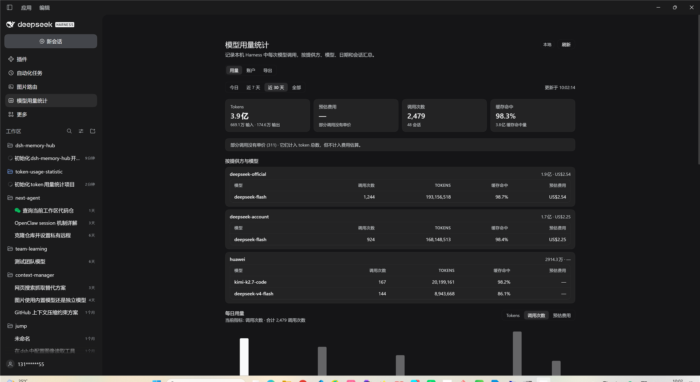
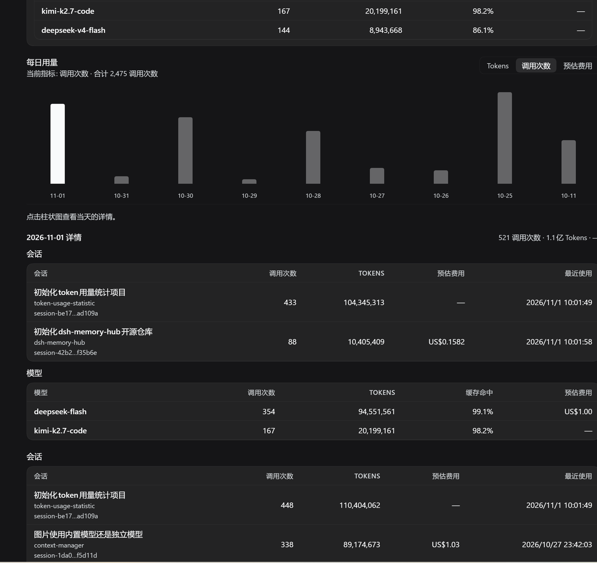
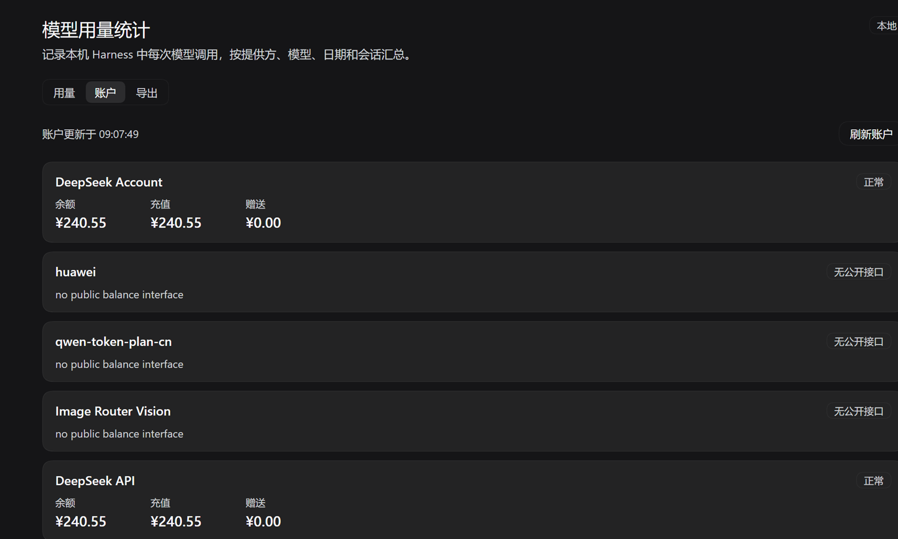
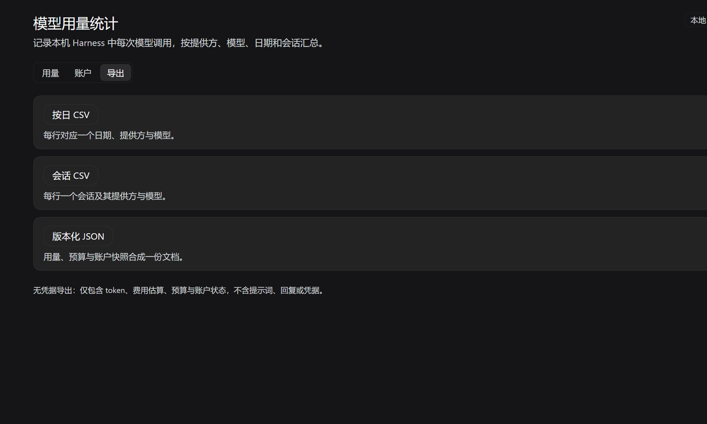

# token-usage-statistic

DeepSeek Harness（DSH）插件：统计**本机所有模型调用**的 token 用量与**按事件时间估算的费用**，提供历史回填、账户余额/订阅额度、日/月预算与无凭据导出，并在侧边栏面板中呈现。同时适配 DSH Desktop 与 DSH Web —— 两者加载同一份 Web 客户端包和同一套 Host 插件图，因此只有一份实现。

`1.0.2` 把每日图表的指标切换（Tokens / 调用次数 / 预估费用）移到图表标题旁，并增加“当前指标 · 合计”摘要，切换后能直接看到数值和柱状图变化；同时补齐了 Desktop / Web 的安装说明。

> **Desktop**：`npm run plugin:install -- desktop` · **Web**：`dsh plugin --profile web add token-usage-statistic`

[安装](#安装) · [使用](#使用) · [配置](#配置) · [开发](#开发) · [排障](#排障) · [参考](#参考) · [完整文档](docs/README.md)

## 界面预览





| 账户余额与订阅额度 | 无凭据导出 |
| --- | --- |
|  |  |

## 能力

| 能力 | 说明 |
| --- | --- |
| 用量采样 | `assistant/message`、`assistant/chunk`、`compaction/summary` 三源；同一 `turn:step` 的后续样本替换先前样本 |
| 历史回填 | 启动后增量扫描 `sessionPersistence`；账本中每个会话的最高 seq 就是游标，fork 从 `inheritedEventCount` 起读 |
| 费用估算 | 每个样本按**自己的事件时间**匹配历史价格规则（DeepSeek 峰谷时段、上海时区）；未定价 fail-closed |
| 账户余额 | DSH Desktop 账户服务、官方 DeepSeek API Key、`llm-pi-ai` provider 的公开余额接口 |
| 订阅额度 | 通用 JSON Pointer 映射的额度窗口（已用/上限/剩余/重置时间），支持自定义 monitor |
| 预算 | 日/月上限、80% 预警/超限状态；费用不完整时不拿部分和比较 |
| 导出 | 按日 CSV、会话 CSV、版本化 JSON；无凭据、Excel 安全 |
| 面板 | 用量 / 账户 / 导出三个标签页，中英文文案跟随界面语言 |

## 架构

```
Session 事件（DSH 的真相来源）
  assistant/message · assistant/chunk · compaction/summary
        │
        ▼
┌──────────────────── Host（src/host）─────────────────────┐
│ collector  事件 → 样本（route/turn:step/usage）           │
│ pricing    事件时间 → 单价规则 → 单样本费用               │
│ store      样本 → 日/模型/会话折叠（替换＝先减后加）       │
│ ledger     每次接受追加一行 JSONL（可重放）               │
│ backfill   sessionPersistence 增量补历史（后台、限并发）   │
│ accounts   发现/刷新账户，凭据只在 Host 解析，结果归一化    │
│ budgets    日/月费用与上限状态                            │
│ api        summary · accounts · 3 个导出端点              │
└───────────────────────────────────────────────────────────┘
        │ same-origin fetch（仅回环）
        ▼
┌──────────────────── Client（src/client）──────────────────┐
│ sidebar.panellist  侧边栏行（文案 thunk 跟随语言）         │
│ main (key=token-usage)  面板：用量 / 账户 / 导出           │
└───────────────────────────────────────────────────────────┘
```

设计要点：

- **账本是唯一可重放的来源**。内存折叠是从账本重建的派生态；重启、热更新、重装都不会丢统计。
- **费用不落盘**。账本只存原始 token 桶与路由，费用在重放时按价格规则重新计算 —— 价格表更新后可以重算历史。
- **账户凭据不出 Host**。`credentials.resolve()` 只在每次刷新时于 Host 内调用；落盘缓存 `accounts.json` 与接口响应都只有归一化数字和粗粒度错误码。
- **网络出口有边界**。账户查询仅 HTTPS（回环允许 HTTP）、不跟随重定向、15 秒超时、1 MiB 上限、拒绝 URL 内嵌凭据。
- **同源 HTTP 而不是生成式 Remote**。路由必须是 `exact`（当前 Web 载体接受 `prefix` 注册但不派发）；所有端点只接受回环 GET/HEAD。

## 目录

```
src/host/usage.ts          纯函数：token 桶、日键、事件采样、v1→v2 迁移
src/host/pricing.ts        DeepSeek 历史价格表、峰谷规则、模型别名
src/host/cost.ts           费用累加器与 fail-closed 渲染
src/host/store.ts          折叠、替换、范围过滤、快照、导出行
src/host/ledger.ts         JSONL 串行追加与坏行跳过
src/host/collector.ts      事件 → 样本，route 回退
src/host/backfill.ts       持久化会话增量回填（含 fork 边界）
src/host/accounts/         账户类型、网络、schemes、注册表与刷新调度
src/host/budgets.ts        日/月预算
src/host/export.ts         CSV/JSON 投影与 CSV 注入防护
src/host/api.ts            只读 HTTP 路由
src/host/config.ts         配置归一化
src/host/index.ts          Host 入口 apply()
src/client/*.ts            React 面板、格式化、i18n、React 绑定
index.js / client.js       esbuild 构建产物（仓库内提交）
test/                      vitest 单元测试（135 个）
scripts/smoke-client.mjs   对构建后的 client.js 做假 shell 冒烟
tools/plugin-install.mjs   安装脚本：定位 Desktop 自带 dsh，链接/安装本包
```

## 安装

> Desktop 与 Web 使用不同的 profile（`desktop` / `web`），两端都装需各执行一次。Desktop 安装前先**完全退出 App（含托盘图标）**。本地安装脚本需要 Node.js ≥ 20；只走图形界面安装则不需要。

**DSH Desktop**（不需要 PATH 上有 `dsh`）

```powershell
npm run plugin:install -- desktop        # 链接当前仓库
npm run plugin:install -- desktop --npm  # 安装 npm 上已发布的包
```

**DSH Web**

```bash
dsh plugin --profile web add token-usage-statistic
dsh web
```

> Web 走 npm 安装的 `dsh`，需要 PATH 上有 `pnpm`；Desktop 自带的 `dsh` 已内置 pnpm。

图形界面（Desktop）：**插件 / Plugins** → 输入 `token-usage-statistic` → 安装 → 重启 Desktop。

装完后侧栏出现「模型用量统计」。入口没出现？→ [排障](#排障)。

> 本插件尚未收录官方插件库，Discover / 市场搜不到是正常的；按包名安装即可。

GitHub 源码、本地目录 / tarball、离线安装、手动 patch、卸载 → [安装细节](#安装细节)。

**兼容性**

| 运行环境 | 支持 | 面板 |
| --- | --- | --- |
| DSH Desktop | ✅ | 侧边栏「模型用量统计」 |
| DSH Web (`dsh web`) | ✅ | 同一个侧边栏面板 |
| DSH CLI / headless | ⚠️ 仅采集 | 无侧边栏；账本仍写入，但面板与 HTTP 导出依赖 Web 载体 |

## 使用

- 侧栏 →「模型用量统计」，三个标签：**用量 / 账户 / 导出**。
- 时间范围：今天 / 7 天 / 30 天 / 全部；图表指标：Tokens / 调用次数 / 预估费用。
- 点每日柱子查看当天会话、模型与工作区；数据在启动后自动回填。

## 配置

最小示例：

```yaml
- override:
    - id: token-usage-statistic
      config:
        refreshMs: 15000
        budgets:
          currency: USD
          daily: 5
          monthly: 50
```

完整字段（`dataFile`、`sessionLimit`、`backfill`、`modelAliases`、`pricing`、`accounts.monitors`）见 [配置参考](#配置参考)。

## 账户与额度

自动发现三类来源：

1. **DSH Desktop 账户**（`deepseekAccount` Host 服务）：登录后读取充值/赠送钱包；未登录显示「未登录」。
2. **官方 DeepSeek API Key**（`llm-deepseek`）：`GET /user/balance`。
3. **`llm-pi-ai` provider**：按 provider id 或 host 匹配内置 scheme（DeepSeek、Moonshot、Z.AI、OpenRouter、OrcaRouter）；没有公开接口的 provider 显示「无公开接口」，不会发起猜测性请求。

`accounts.monitors` 可以补上任意私有监控端点：`baseURL` 必须是完整 URL，数值用 JSON Pointer 选取；`mode: subscription` 时用 `windows` 指针选取额度数组。

- 刷新在后台进行（默认 10 分钟），面板「刷新账户」会立即触发一次。
- 最近一次结果写入 `accounts.json`，重启后先显示旧值并标记 stale，直到刷新成功。
- 凭据只经 `ctx.credentials` 在 Host 内解析，响应与导出都不含密钥、请求头或上游原始 JSON。

## 预算

`budgets.daily` / `budgets.monthly` 与 `budgets.currency` 定义上限。预算只汇总面板已经展示的同一批费用估算：

- 达到 80% 为 `warn`，达到 100% 为 `exceeded`；
- 窗口内任一样本未定价或币种不一致时，`costComplete: false`，不下结论、不显示百分比；
- 未配置上限时不显示预算条。

## 导出

| 端点 | 内容 |
| --- | --- |
| `GET /token-usage-statistic/api/export/daily.csv` | 每行一个日期 + provider + model |
| `GET /token-usage-statistic/api/export/sessions.csv` | 每行一个会话及其 provider/model 集合 |
| `GET /token-usage-statistic/api/export.json` | `schemaVersion: 1.0.0`，含用量、预算与账户快照 |

CSV 带 UTF-8 BOM、CRLF、双引号转义，并对以 `= + - @` 开头的文本加前导单引号（防公式注入）。导出只复制允许列表字段，不含提示词、回复、文件路径或凭据。

## 价格口径

内置目录为 DeepSeek 官方 USD 价（每 1M tokens），覆盖 `deepseek-v4-flash` / `deepseek-v4-pro` 的三段历史：平价期、全周峰谷期、工作日峰谷期；峰时段为上海时间 09:00–12:00 与 14:00–18:00。

- 桌面账号路由上报的 `deepseek-flash` / `deepseek-pro` 通过内置别名映射到 `v4` 规则；可用 `modelAliases` 覆盖。
- 只有 `pricing.providers` 内的路由会被计价；第三方网关默认**未定价**。
- 任一样本缺少可靠单价时金额为 `null`，面板显示「—」并提示未定价样本数；token 总数不受影响。

## API

| 方法 | 路径 | 说明 |
| --- | --- | --- |
| `GET` | `/token-usage-statistic/api/summary` | 用量、费用、预算、回填状态；`days=1\|7\|30\|all` |
| `GET` | `/token-usage-statistic/api/accounts` | 账户快照；`refresh=1` 触发后台刷新 |
| `GET` | `/token-usage-statistic/api/export/daily.csv` | 按日 provider/model CSV |
| `GET` | `/token-usage-statistic/api/export/sessions.csv` | 会话 CSV |
| `GET` | `/token-usage-statistic/api/export.json` | 版本化 JSON |

所有端点只读、仅回环、`cache-control: no-store`；非回环请求返回 `403`，非 GET/HEAD 返回 `405`。

## 数据与迁移

- 账本：默认 `%DSH_HOME%\token-usage-statistic\usage.jsonl`，一行一个样本。
- `accounts.json`：最近一次账户快照，可删；不会包含凭据。
- `activation.json`：每次激活的路由回执（`registered` / 失败原因），排障用，可删。
- v1 记录（无 `sampleKey`）在加载时自动迁移为 `assistant:<seq>`。
- 清空重来：停用插件 → 删除 `usage.jsonl` → 启用（会重新回填历史）。

字段与迁移规则见 [存储契约](docs/01-architecture/storage-contract.md)。

## 开发

```powershell
npm install
npm run build       # esbuild → index.js + client.js
npm run typecheck   # tsc --noEmit
npm test            # vitest，135 个用例
npm run test:bundle # 对构建后的 client.js 做假 shell 冒烟
npm run check       # typecheck + build + test + bundle smoke
```

改完 Host 代码后，将插件行 `include:token-usage-statistic` 禁用再启用即可重新导入模块；Client 代码刷新页面即可。

开发规范见 [development-guide.md](docs/04-development/development-guide.md)。

## 排障

更多症状与处理见 [troubleshooting.md](docs/06-operations/troubleshooting.md)。

- **面板 404**：看 `activation.json`。`route: "failed"` 带原因；文件不存在说明 `webServer` 未注入。
- **账户显示「无公开接口」**：该 provider 没有内置 scheme，用 `accounts.monitors` 配一个通用映射。
- **账户显示「未登录/未配置」**：在 DSH 中登录 DeepSeek 账户，或配置对应 `apiKeyEnv` 后点「刷新账户」。
- **账户查询失败**：显示粗粒度原因（超时、401、限流、响应非法），不会记录或显示密钥。
- **费用/预算为「—」**：存在未定价路由或模型；用 `pricing.providers` / `modelAliases` / `pricing.rules` 扩展。
- **导出 403**：端点只接受回环请求，不要经反向代理暴露到局域网。

## 参考

### 安装细节

完整说明见 [installation-guide.md](docs/06-operations/installation-guide.md)。

#### Desktop 的 `dsh` 是什么

`dsh` 是 DeepSeek Harness 的命令行入口。Desktop 自带一份运行时（Node、pnpm、dsh），但**不加入 PATH**：直接敲 `dsh` 可能找不到，或命中 npm 全局版本。`npm run plugin:install -- desktop` 会自动定位 App 自带的 CLI，所以 Desktop 安装不要求 PATH 上有 `dsh`。

手动执行时用完整路径：

```powershell
$dsh = "$env:LOCALAPPDATA\Programs\DeepSeek Harness\resources\runtime\cli\bin\dsh.cmd"
& $dsh plugin --profile desktop add token-usage-statistic
```

下文 `$dsh` 均指这个路径。

能否使用 `--profile desktop` 取决于 `dsh` 的来源：

| 来源 | `--profile desktop` |
| --- | --- |
| Desktop 自带 | 支持，且内置 pnpm |
| npm `@deepseek-ai/dsh` ≤ `0.1.3` | 支持（早期版本没有限制） |
| npm `@deepseek-ai/dsh` ≥ `0.1.5-alpha.1`（含 `0.2.1-rc.5`） | 拒绝 |

npm 新版报：

```text
error: profile "desktop" is managed exclusively by the Electron application
```

检查当前命中：`where.exe dsh`、`dsh --version`。执行安装或卸载前先完全退出 Desktop（含托盘图标），装完再启动；Host 代码只在启动时加载。

#### GitHub 源码

```powershell
# Web
dsh plugin --profile web add github:zhiwuli0228/token-usage-statistic

# Desktop（先完全退出）
& $dsh plugin --profile desktop add github:zhiwuli0228/token-usage-statistic
```

git 托管安装需要本机有 `git`。如果 pnpm 拦截了包的构建脚本，按提示把打印出的键加到对应 profile 的 `pnpm-workspace.yaml` 的 `allowBuilds` 下再重试。

#### 本地 / 离线安装

安装不需要构建：仓库已提交 `index.js`、`client.js` 等产物。目录安装是 `link:`，源目录不能删/移；tarball 会复制进 profile，源目录可移走，但以后重装仍需该 tgz。

```powershell
# 在本仓库里（Desktop 先完全退出）
npm run plugin:install -- desktop --offline
npm run plugin:install -- web --offline

# 指定目录或 tarball
npm run plugin:install -- desktop --spec "D:\offline\token-usage-statistic" --offline
npm run plugin:install -- desktop --spec "D:\offline\token-usage-statistic-1.0.2.tgz" --offline
```

没有本仓库时直接调 CLI：

```powershell
$dsh = "$env:LOCALAPPDATA\Programs\DeepSeek Harness\resources\runtime\cli\bin\dsh.cmd"

& $dsh plugin --profile desktop add "D:\offline\token-usage-statistic" --offline
& $dsh plugin --profile desktop add "D:\offline\token-usage-statistic-1.0.2.tgz" --offline

dsh plugin --profile web add "D:\offline\token-usage-statistic" --offline
dsh plugin --profile web add "D:\offline\token-usage-statistic-1.0.2.tgz" --offline
```

`--offline` 让 pnpm 不访问 registry；目录和 tarball 都不需要网络。Desktop 自带的 `dsh` 已内置 pnpm；Web 需要 PATH 上有 `pnpm`。

Desktop 会话里也可以让 agent 执行：`plugin_manager( action: "install_bundle", target: "D:\\offline\\token-usage-statistic" )`，作用于当前会话所在的 profile。

只有改了 `src/` 才需要构建：`npm install && npm run build`。

#### 手动 patch（高级）

如果不用插件管理器，可以把包加入 profile 的 `package.json` 依赖，并在该 profile 的 `cordis.patch.yml` 中插入：

```yaml
- insert:
    - id: token-usage-statistic
      name: token-usage-statistic
```

profile 目录：

- Desktop：`%DSH_HOME%\profiles\desktop`
- Web：`%DSH_HOME%\profiles\web`

然后重新加载 profile。手改 patch 容易与 Desktop 的 profile 恢复流程冲突，能用 `dsh plugin` 就不要手改。

#### 检查与卸载

```powershell
# 检查
dsh plugin --profile web list | findstr token-usage-statistic
& $dsh plugin --profile desktop list | findstr token-usage-statistic

# 卸载
dsh plugin --profile web remove token-usage-statistic
& $dsh plugin --profile desktop remove token-usage-statistic
```

输出中应出现 `token-usage-statistic@`（npm/tarball 安装显示版本号，本地目录链接显示 `link:` 路径）。卸载不会删除账本，`usage.jsonl` 仍然保留。

### 配置参考

所有字段可选，非法值回退默认：

```yaml
- override:
    - id: token-usage-statistic
      config:
        dataFile: 'D:\\dsh-data\\usage.jsonl'   # 默认 $DSH_HOME/token-usage-statistic/usage.jsonl
        refreshMs: 60000                        # 面板轮询，最小 3000，默认 15000
        sessionLimit: 12                        # 会话表条数，1..100
        recentLimit: 200                        # 内存保留的最近样本，0..5000
        backfill: true                          # 是否回填历史会话
        modelAliases:                           # 额外模型别名（覆盖内置）
          deepseek-flash: deepseek-v4-flash
        pricing:
          providers: [deepseek, deepseek-account, deepseek-official]  # 视为官方路由、可计价
          rules: []                             # 追加自定义价格规则
        accounts:
          refreshMs: 600000                     # 账户刷新，最小 60000
          timeoutMs: 15000                      # 单次账户请求超时
          monitors:                             # 显式账户 monitor（可覆盖自动发现）
            - id: coding-plan
              displayName: Coding Plan
              mode: subscription                # balance | subscription
              baseURL: https://billing.example.com/usage
              credentialRef: MY_PLAN_API_KEY    # 由 credentials 服务解析
              subscription:
                plan: /plan/name
                windows: /data/windows
                fields:
                  id: /key
                  label: /label
                  used: /used
                  limit: /total
                  remaining: /remaining
                  unit: /unit
                  resetAt: /reset_at
        budgets:
          currency: USD
          daily: 5
          monthly: 50
```

## 范围与限制

- 账户只覆盖有公开接口的来源；私有/需登录抓取的额度不做模拟，可由 `accounts.monitors` 自行接入。
- 没有推送通知或后台告警通道：预算状态只在面板与导出中呈现。
- 账本没有轮转/上限；长期使用后文件会增长。
- 面板视觉呈现尚未经过真人验收（槽位注册、接口、构建产物冒烟均已通过）。

## 与参考项目的关系

采样口径、替换语义、价格规则结构、账户 scheme 形态与 fail-closed 费用渲染参考了 [`Ychris12138/dsh-usage-stats`](https://github.com/Ychris12138/dsh-usage-stats)（MIT）。本实现是独立的 TypeScript 代码库，只保留用量/费用/账户/预算/导出这条主线，账户发现与刷新调度自行实现。

## Roadmap

1. 账本轮转与按区间清理。
2. 更多内置订阅 scheme（Qwen Token Plan、Kimi、MiniMax）与官方价格目录。
3. 预算阈值通知（DSH 通知或 webhook）。
4. 月历热图与模型筛选。
5. 面板视觉与交互的细节打磨。

## License

[MIT](LICENSE) © 2026 zhiwuli0228
