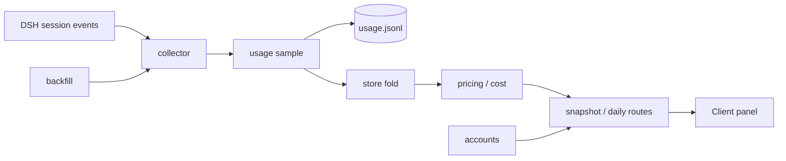

# Design

## Overview

`token-usage-statistic` is a DSH bundle with two halves:

- Host: observes session events, maintains a replayable ledger, estimates cost, queries accounts, and serves read-only JSON/CSV.
- Client: registers a sidebar entry and renders the usage / accounts / export panel.

The Host is the only half that touches the filesystem, credentials, or provider APIs. The Client only reads the Host's loopback HTTP routes.

## Architecture Principles

```text
The JSONL ledger is durable truth.
In-memory folds and browser caches are rebuildable.
Cost is derived at replay time.
Missing prices fail closed.
Credentials never leave the Host.
The UI never blocks on the widest range.
```

## Data Flow



## Request Flow

```text
Client opens panel
→ read today's cached snapshot (if any)
→ GET /token-usage-statistic/api/summary?days=1
→ render today's metrics, providers, sessions, chart
→ prefetch 7 / 30 day windows in the background
→ when the user widens the range, show the best cached window
→ refresh the exact range in the background
```

## Main Outputs

Panel tabs:

- Usage: totals, provider/model rows, daily chart, day detail, session table.
- Accounts: balances, quota windows, unsupported sources.
- Export: daily CSV, sessions CSV, versioned JSON.

Host routes:

```text
GET /token-usage-statistic/api/summary
GET /token-usage-statistic/api/daily
GET /token-usage-statistic/api/accounts
GET /token-usage-statistic/api/export/daily.csv
GET /token-usage-statistic/api/export/sessions.csv
GET /token-usage-statistic/api/export.json
```

All routes are exact, read-only, loopback-only, and `cache-control: no-store`.

## Memory Behavior

- The ledger is replayed once at activation into an in-memory fold.
- The recent-sample list is bounded (`recentLimit`).
- Snapshot requests iterate only the days in the requested window.
- The client never holds full history; it caches only the snapshots it has requested.
- No unbounded history scan is allowed on the request path.

## Security Boundary

- Account credentials are resolved only via `ctx.credentials` inside the Host.
- Account network requests are HTTPS-only (loopback may use HTTP), do not follow redirects, have a 15s timeout and a 1 MiB response cap.
- Exports contain only an allow-list of normalized fields.
- CSV text cells are protected against formula injection.
