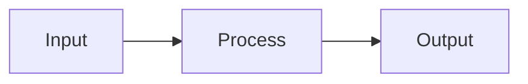

# Design: {change_name}

## 1. Overview

## 2. Data Flow

## 3. Module Responsibilities

## 4. Contracts

- Host route:
- Storage file:
- Client cache:
- UI state:

## 5. Failure Behavior

## 6. Security and Privacy

## 7. Performance and Memory

## 8. Tests

## 9. Compatibility

## 10. Open Questions
